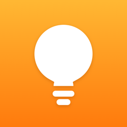
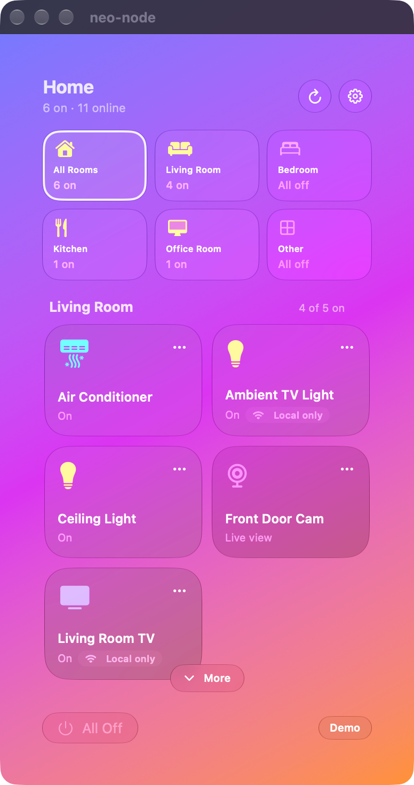
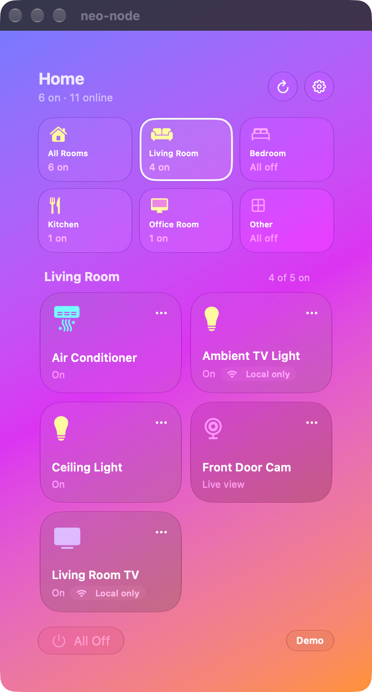
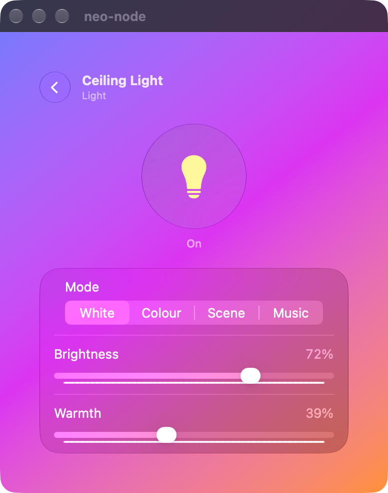
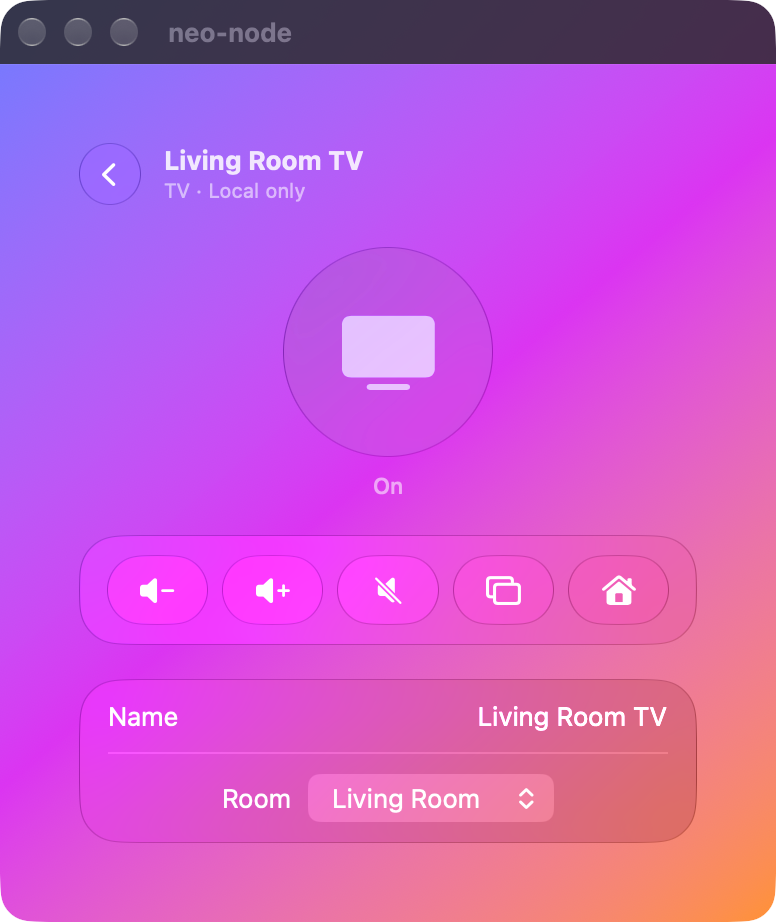
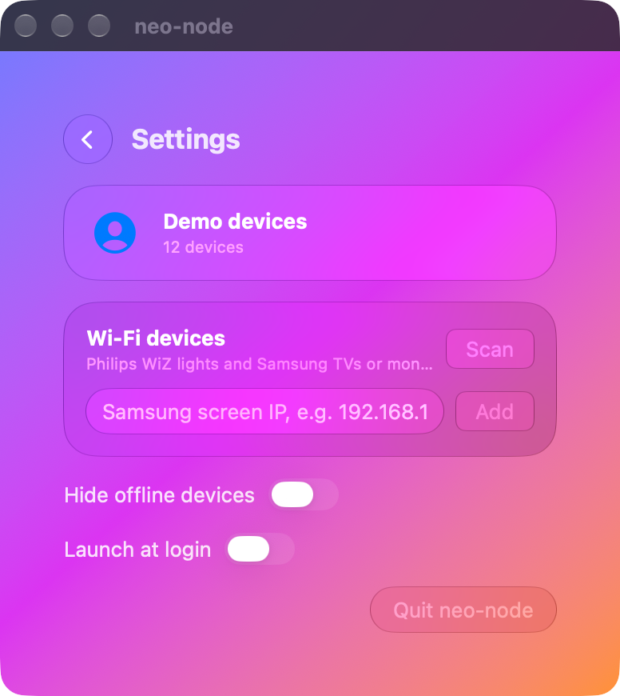
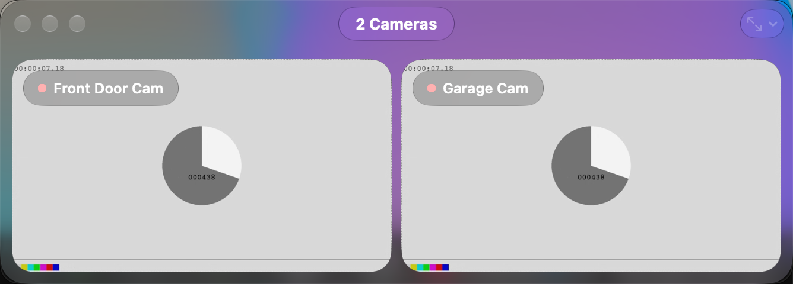

<p align="center">
  
</p>

<h1 align="center">neo-node</h1>

<p align="center">
  A Liquid Glass menu bar app for macOS 27 that runs your whole smart home from one place:<br>
  Tuya / Smart Life (including live cameras), Philips WiZ lights and Samsung TVs and Smart Monitors.
</p>

<p align="center">
  
  &nbsp;
  
</p>

> Screenshots use the built-in demo data (`-demo`), not a real home.

## Features

| | |
|---|---|
| **Rooms** | Devices grouped by the rooms in your Smart Life app. Room shortcuts on top filter the list; drag shortcuts, sections or device tiles to rearrange (the others slide aside), and the order is remembered. |
| **One tap** | Tap a tile to switch it on or off. `…` opens brightness, warmth, mode, scenes and extra switches, built from each device's own capabilities. |
| **Cameras** | Click a camera to open a glass window at the top right with the live view. Open several side by side, drag to rearrange, pan/tilt, privacy, motion, recording and night-vision settings, sizes from Extra Small to Extra Large, Keep on Top. |
| **Philips WiZ** | On/off, brightness, warmth and WiZ scenes, straight over your Wi‑Fi. |
| **Samsung TVs and Smart Monitors** | Power, volume, mute, input and Home over your Wi‑Fi; turns screens on with Wake‑on‑LAN. |
| **Tidy** | Hide offline devices, All Off, launch at login, right-click the menu bar icon to quit. |

WiZ and Samsung devices are marked **Local only**: they work while your Mac is on your home Wi‑Fi.

<p align="center">
  
  &nbsp;
  
  &nbsp;
  
</p>

<p align="center">
  
</p>

## Install

1. Download the latest **neo-node-x.y.z.dmg** from [Releases](../../releases).
2. Open it and drag **neo-node** onto **Applications**.
3. Open neo-node. It lives in the menu bar (no Dock icon).
4. When macOS asks to find devices on your local network, choose **Allow** (needed for WiZ and Samsung).

Requires macOS 27. Current builds are development-signed, not notarized: on a Mac other than the one that built it, open **System Settings › Privacy & Security** and choose **Open Anyway** the first time.

## Connect your devices

### Tuya / Smart Life

1. In Smart Life: **Me › Settings › Account and Security › User Code**.
2. Paste the code into neo-node, then scan the QR code with Smart Life (scan icon on the Me tab) and confirm.

This is Tuya's QR login from [`tuya-device-sharing-sdk`](https://github.com/tuya/tuya-device-sharing-sdk), ported to Swift (`neo-node/Tuya/SmartLifeClient.swift`). Tuya only issues it to partners, so neo-node uses Home Assistant's client ID: Smart Life lists the authorization as **Home Assistant**, and it stops working if Tuya revokes that ID. The session is kept in the keychain and refreshed automatically.

Fallback: **Use a Cloud project** takes the Access ID and Secret of a Tuya Cloud project at [platform.tuya.com](https://platform.tuya.com) with your app account linked (Devices › Link App Account).

### Philips WiZ

Found automatically on your Wi‑Fi. Give each light a name and room from its `…` details (WiZ doesn't share those over Wi‑Fi).

### Samsung TV / Smart Monitor

Found automatically, or add one by IP in **Settings › Wi‑Fi devices**. The first command makes the screen ask to **Allow neo-node**. For power-on, enable **Settings › General › Network › Expert Settings › Power On with Mobile** on the screen.

## Build

Needs Xcode 27 and [XcodeGen](https://github.com/yonaskolb/XcodeGen).

```sh
xcodegen generate
xcodebuild -project neo-node.xcodeproj -scheme neo-node -derivedDataPath build build
open build/Build/Products/Debug/neo-node.app
```

The app icon is drawn by `scripts/make-icon.swift`; after changing it, regenerate the PNGs:

```sh
swift scripts/make-icon.swift neo-node/Assets.xcassets/AppIcon.appiconset/icon_1024.png
for s in 16 32 64 128 256 512; do
  sips -z $s $s neo-node/Assets.xcassets/AppIcon.appiconset/icon_1024.png \
    --out neo-node/Assets.xcassets/AppIcon.appiconset/icon_$s.png
done
```

### Launch arguments (development and screenshots)

| Argument | Effect |
|---|---|
| `-demo` | Dummy devices, rooms and cameras; no account or network needed |
| `-window` | Shows the menu in a regular window |
| `-route settings` / `-route detail:<id>` | Opens that screen, e.g. `-route detail:d1` |
| `-openCameras all` | Opens the camera window with every camera |
| `-addSamsung <ip>` | Adds a Samsung screen and reports why if it can't |
| `-wizDiagnostics` | Shows what each known WiZ light reports (state, model, config) |
| `-keychainDiagnostics` | Shows where the saved login is found |

The screenshots above were made with:

```sh
open build/Build/Products/Debug/neo-node.app --args -demo -hidesOfflineDevices NO -window
```

## Notes

- Devices refresh when the menu opens (at most every 10 s); there's no background polling.
- A Tuya Cloud project's free trial must be extended every few months on the Tuya platform, or its API calls stop.
- Data moved from the old `com.rahmad.TuyaBar` bundle automatically on first launch (`neo-node/Store/Migration.swift`).
